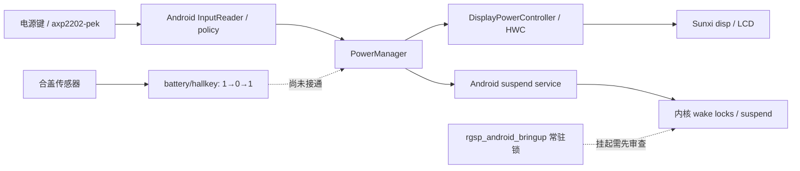

# RG34XXSP 硬件链路对照与实体验收

日期：2026-10-29。对象为当前 H700 / 2GB / 双摇杆样机，Android 10、ARM32 用户空间。当前软件检查点仍为 Navigation v7；本轮安装第三方测试应用、读取接口及调整后恢复测试设置，没有构建系统、更新 boot/system/vendor 或重封装 IMG。

## 结论

当前外放和实体音量键已通过听音验收；电源键熄屏、唤醒及 A 解锁通过。亮度设置和合盖自动熄屏确有缺口，不能用服务存在或设置值变化判为通过。

本轮最关键的补充是重新核对原厂扩展接口：`axp2202-battery/hallkey` 在开盖、合盖、开盖时依次为 **1 → 0 → 1**，传感器能报告变化，但 Android 仍保持 Awake / ON。亮度设置从 32 到 224，驱动仍显示背光 50，用户未见明显变化；当前未找到已安装的 Lights HAL 模块或已注册的 Light 服务。后续优先接通 Android 与这些后端之间的链路。

## 参考材料的适用边界

- [原厂 H700 硬件基线，冻结标签中的原文](https://github.com/LPF970915/H700Android/blob/baseline/h700-v5i-usb-network-20261028/docs/RG34XXSP_H700_SYSTEM_HARDWARE_BASELINE.md)：2026-08-07 的原厂 Linux、约 1GB 样本，提供板级接口事实；不是当前 Android 的验收结果。
- [最早 Android 10 主计划及历史更新](https://github.com/LPF970915/H700Android/blob/baseline/h700-v5i-usb-network-20261028/docs/H700_ANDROID10_MASTER_PLAN_20260902.md)：用于判断原计划，里面的旧设备、双卡启动和部署脚本不应在当前单卡系统重放。
- [H616 Android 10 来源及优先级](H616_ANDROID10_PROVENANCE_20260902.md)：借用框架和 Allwinner HAL 源码，板级事实以 H700 实机为准。
- [当前开发增量](RG34XXSP_DEVELOPMENT_20261028.md)、[v7 鼠标及实体肩键记录](RG34XXSP_SELECT_HOLD_20261028.md)、[此前电源与应用盘点](RG34XXSP_INPUT_POWER_EMULATORS_20261028.md)。
- `D:/Works/ROCreader/src/system_controls.cpp` 仅只读对照，未修改 ROCreader。它通过 `/dev/disp` 的 `0x102/0x103` ioctl 设置/读取亮度，采用 20…226 的原始值工作区间。该实现不能推出 battery/brightness 的合法范围，后者本轮没有写入。

旧文档的 Linux arm64 应用栈、systemd/NetworkManager/BlueZ、SDL/直接 ALSA，不能照搬为 Android 应用接口。当前应用应继续使用 Android 图形、输入、音频和电源 API，由 HAL 或平台适配层访问硬件。

## 逐层对照

| 项目 | 原资料中的硬件端 | 当前 Android 链路及证据 | 缺口 / 后续动作 |
| --- | --- | --- | --- |
| SoC / 内存 | H700，BSP 沿用 H616 / sun50iw9p1 标识；旧样本约 973MiB | 当前 `MemTotal=2027136kB`，Android API 29、armeabi-v7a | 不能据 H616 产品名判断机型，也不能把当前结果当成 1GB 性能验收 |
| 显示 / GPU | Linux 4.9.170；fb0、disp、ION、Mali-G31，非 DRM/KMS | Android SurfaceFlinger → HWC / gralloc / 厂商 EGL → disp / ION / Mali；当前 720×480、213dpi | 软件 VSYNC 仍在使用，硬件 VSYNC 与完整显示稳定性未解决；不切换到 Panfrost/KMS |
| 亮度 | battery/brightness 厂商属性；无标准 backlight class | 设置与 DisplayPowerController 确实接收到亮度变化；厂商属性为 5、disp 背光 50，未随设置改变。lshal 未列 Light，32/64 位 HAL 常见安装目录均未找到 lights 模块，VINTF 未声明 Light | 保留的 `hardware/aw/lights/de/lights.c` 已有 `/dev/disp` + `DISP_CMD_LCD_SET_BRIGHTNESS` 实现；应先审查并补入产品包和 Android Light 服务，再低压构建、保留回退并验收。缺失模块是明确配置缺口，尚未通过安装修复证明唯一根因 |
| 实体按键 | ANBERNIC-keys，厂商 BTN 名称与物理语义错位 | evdev → Android `.kl` / InputReader → 应用与 Navigation；四肩键实体采样与当前布局一致 | 不按 SDL 编号或标准 BTN 名称盲目交换肩键；L3/R3 与重复节奏仍待单独验收 |
| 双摇杆 | 机型 GPIO 复用与 ADC，不能由无摇杆 RGSP 推出 | 已有按机型启用的附加模块，向原控制器增加四轴；用户确认两杆和十字键移动鼠标正常 | 量化端点和 L3/R3 按压待测；不推广到其他 H700 机型 |
| 合盖 | `/sys/class/power_supply/axp2202-battery/hallkey` | 实体开合 1→0→1；当前输入未提供 SW_LID，策略 `LID_BEHAVIOR_NONE`，合盖保持 Awake / ON | 接通厂商信号到 Android 电源策略。需去抖、明确开合极性、开机状态及休眠恢复；不能只直接关背光，留下应用和 CPU 活动 |
| 电源键 | axp2202-pek 输入 | evdev → Android policy / PowerManager → 显示关断；实体短按后 Asleep / OFF，再按唤醒并 A 解锁 | 这证明 Android 屏幕睡眠，不证明内核深度挂起。锁屏壁纸细节本轮未再次单独确认 |
| 深度挂起 | 内核 `/sys/power/state` 有 freeze / mem；原 Linux 前端直接请求 mem | 当前 init 仍获取 `rgsp_android_bringup`，运行中 wake_lock 也含此项；USB 下 `stay_on_while_plugged_in=7` | 优先区分常亮设置、框架睡眠和内核挂起；评估常驻 bringup 锁并准备回退后，才做拔线、自动息屏、唤醒、续航。不能把直接 echo mem 当作 Android 适配 |
| 外放 | ALSA card 0 `audiocodec` / hw:0,0；LINEOUT、SPK、DAC mixer、功放 | QQ TV / MediaPlayer → AudioTrack / AudioFlinger → AudioPolicy → Audio HAL 5.0 / `audio.primary.cupid` → ALSA card 0 → LINEOUT / SPK。用户确认歌声正常，实体音量键实际改变音量 | 当前外放通过；首次测试音没听见不能归为硬件失效。失真、左右声道、长播及模拟器声音待测 |
| 耳机 | 原资料有检测 GPIO、`spk_state` 和扬声器控制 | 当前 policy 声明 Wired Headset / Headphones；产品 mixer XML 仅提供 media-speaker / media-single-speaker，未提供专用耳机 path。未插耳机时 spk_state=1 | policy 声明不代表检测和路由已接通；需插拔时同时检查厂商值、Android 路由、扬声器静音、左右声道。不能先把 spk_state 当作可写开关 |
| 电池 / 充电 | AXP2202 battery / USB power_supply | Health 2.0 → BatteryService；本次 USB=true、100%、Full，电压约 4.086V，电池 30°C | 上报存在不等于电量校准、充电切换或实际续航通过；待拔插及电池供电测试 |
| CPU / 温控 | cpufreq-dt，480…1512MHz，CPU/GPU/VE/DDR/电池温度 | 当前可读同组频点，governor=performance；CPU 约 55.8°C，GPU 约 51.4°C。此前 Android Thermal HAL 未就绪 | 单次温度不代表热稳定；先核对 governor 策略及内核保护，再测负载/温升/降频。未擅自改变调频策略 |
| Wi-Fi | RTL8821CS SDIO，原系统使用 NetworkManager | 驱动 / firmware → Android Wi-Fi HAL / supplicant → Connectivity；现有 USB/联网与重启证据见当前基线，QQ TV 也实际在线播放 | 休眠后重连、长时稳定性及低电行为仍待测 |
| 蓝牙 | 原厂 RTL UART ttyS1 + rtk_h5 + BlueZ | 当前有 ttyS1，但启用后仍 OFF，框架明确报 `Fail to bind to: Intent { act=android.bluetooth.IBluetooth }`；PackageManager 找不到 com.android.bluetooth，仅有 BluetoothMidiService，未找到 Bluetooth APK 或常见 Bluetooth HAL 模块 | 系统包与 HAL 集成存在缺口；先补齐 Android 栈，再检查 RTL UART/固件。已恢复原 OFF，未扫描或配对；原厂 BlueZ/hciattach 不可直接替代 Android HAL |
| HDMI | 厂商 disp 热插拔；ALSA card 2 ahubhdmi | 当前 ALSA 仍列 card 2；policy 声明 HDMI Out | 没有线和显示器，热插拔、画面、声音、拔出回内屏均待测；card 注册不等于输出通过 |
| USB / 存储 | 原系统旧 gadget、原双卡布局 | 当前 ConfigFS / FunctionFS → USB ADB / MTP；现用单卡 system/vendor/data/ROMS 布局 | 保持当前身份核对和存储保护；完整 MTP、拔线和断电冷启仍待测，不重放历史卡修复 |
| LED / 振动 | battery 扩展 LED/moto 与原资料的 PWM 线索 | 本轮仅确认厂商属性存在；控制语义和持有者未验证 | 不凭属性名称直接写入，不并发接管 PWM；后续做限时且可回退的单项测试 |

### 两条不同的电源路径

亮度路径应另行接通：Settings → DisplayPowerController / LightsService → Light HAL → `/dev/disp` → LCD 背光。HWC 的电源开关能工作，并不表示 Light HAL 已经工作。

## 本轮实体结果

| 测试 | 结论 | 依据与限制 |
| --- | --- | --- |
| USB 连接时完全合盖 | 失败 | 用户看到屏幕仍亮，Android Awake / ON；厂商 hallkey 已变化 |
| 电源键短按熄屏 | 通过 | 用户确认熄灭，Android Asleep / OFF |
| 再短按电源键、A 解锁 | 通过 | 用户恢复可见画面，返回 AT4K，boot ID 不变 |
| Android 亮度 32 / 224 | 失败 | 用户未见明显差别，驱动背光均为 50；已恢复原值 102 / 手动模式 |
| 长测试音 | 能出声 | 用户后续听到长蜂鸣；播放器、音量、音源幅度同时变化，不能单独归因最初的静音 |
| QQ 音乐 TV 在线歌曲 | 通过 | 用户亲自播放并确认正常歌声 |
| 实体音量＋/－ | 通过 | 用户确认能实际改变 QQ TV 的声音大小 |
| 有线耳机 | 待测 | 用户有 3.5mm 线，尚未完成插拔和声道测试 |
| 拔线、充电切换、自动息屏、深度挂起、断电冷启 | 待测 | 用户离开设备后不做这些需要实体恢复和观察的测试 |
| 蓝牙框架启用 | 失败 | 请求后仍 OFF，无法绑定 IBluetooth，Bluetooth 主包缺失；已恢复关闭 |
| 蓝牙配对、HDMI | 待测 | 无对应外设，蓝牙栈缺口也尚未修复 |

此前“QQ 音乐正常”指旧 RGSP 和上一版本镜像。本轮 QQ TV 听音才是当前 2GB 样机的证据。

## QQ 音乐 TV 安装锁

来源为 [QQ 音乐官方下载页](https://y.qq.com/download/download.html) 的 **Android TV** 入口；实物 APK 与设备安装结果优先于网页版本描述。详见 [机器可读锁](baselines/rg34xxsp-hardware-20261029/qqmusic-tv-lock.json)。

| 项目 | 值 |
| --- | --- |
| 包名 | `com.tencent.qqmusictv` |
| 版本 | `9.0.0.39` / versionCode `9000039` |
| 最低 SDK / 本机 SDK | 21 / 29 |
| 原生 ABI | 仅 `armeabi-v7a` |
| APK 大小 | 72,156,717 字节 |
| APK SHA-256 | `c37369d85ea817a68e91bb100f1e0994e53b37592c0e80237932f762428128a2` |
| 签名证书 SHA-256 | `bf3db8c6cbbf11104eb62fc20e9dfb27b37445d84bdb529241ed498b0044fa1e` |
| API 29 签名校验 | 通过 |
| 本次验证 | 安装、启动、横屏 720×480 歌曲播放页、用户实际听音及实体音量键 |

本轮先误装官方手机版，已在首次隐私页阶段撤掉；操作前确认本机原先没有该包，没有卸载既有用户应用。最终只保留 TV 版。没有在 Git 或系统镜像中加入 QQ APK，没有登录账号、购买或修改其包签名。后续仍需验证 TV 版的完整十字键浏览、搜索、A/B 和小屏字号，不能因某首歌曲成功就宣布全流程适配通过。

## 后续实施顺序

1. 亮度：补齐 Light 服务/模块的产品集成，核对原厂 disp ABI、权限、非零下限与 0 亮度的熄屏语义；离线构建及回退先完成，再做少量实机读回和实体五档验收。
2. 合盖：为厂商 hallkey 建立 Android 平台适配。优先考虑标准 SW_LID；若暂用平台服务，仍经 PowerManager，请求与电源键相同的系统睡眠流程，避免直接操作 LCD。开盖是否自动唤醒需按实际设备和用户期望验收。
3. 休眠：梳理常驻 bringup 锁与 USB 常亮，保留唤醒恢复路径；不要在无人看护时直接移除锁并强制 mem。
4. 耳机：先查检测与 Android 路由、当前 mixer/HAL 的耳机 path，再做插拔与听音；外放通过不关闭这项缺口。
5. 蓝牙、HDMI、温控、充电与冷启按各自条件推进；完成基础硬件后继续模拟器真实游戏和长时性能，最后重封装交付镜像。

本轮原始 dumpsys、sysfs、截图、下载与安装凭据保存在忽略目录 `out/hardware-acceptance-20261029/`、`out/qqmusic-tv-20261029/`。公开文档不包含序列号、网络地址、MAC、用户应用私有数据和完整原始日志。冻结覆盖层未修改。
